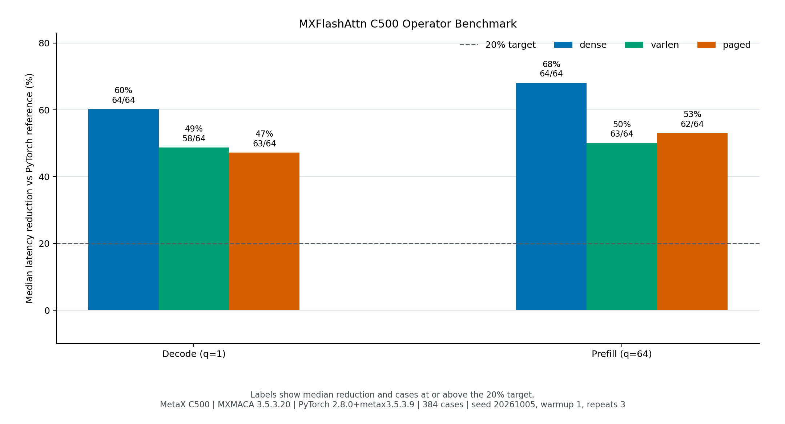

# MXFlashAttn

> **状态（2026-10-13）：v1.3.0 本地发布候选。自研 split-KV decode 内核 M1 已在
> MetaX C500 64G 上完成真实 vLLM 0.17.0 生成、dispatch 和回退验证。**
>
> **项目边界：**这是面向 MXMACA/MetaX C500 的专项适配与 decode 优化工程，
> 不是跨硬件 FlashAttention 替代品，也不是 MXAttention（MXFP4）复现。

中文说明 · **[English](README.en.md)**

MXFlashAttn 是面向 **MXMACA / MetaX C500** 的 FlashAttention 兼容前向算子与推理适配项目。
v1.3.0 起包含**自研 device kernel**（`csrc_native/m1_kernel.cpp`，split-KV paged decode）。
2026-10-13 的 64G C500 复测中，Qwen3-4B 在 batch=32、max_tokens=1024 的长上下文
decode 场景相对本项目 v7 路径达到约 **3.59×** 吞吐；跨模型结果表明收益依赖模型、
batch 和 KV 长度，短序列或低并发不保证加速。

[](https://github.com/leo1852098393-blip/MXFlashAttn/actions/workflows/ci.yml)
[](LICENSE)
[](pyproject.toml)

## 2026-10-13 复测结果（申报主口径）

环境：MetaX C500 64G、MACA 3.5.3.20、驱动 3.8.30、PyTorch
`2.8.0+metax3.5.3.9`、vLLM 0.17.0。所有 M1 结果均由 dispatch 日志确认进入
`m1_split_decode`。

| 模型与场景 | v7 | M1-UM2 | 相对 v7 |
| --- | ---: | ---: | ---: |
| Qwen3-4B，batch=128，256 token | 1375.59 tok/s | 4554.69 tok/s | **3.31×** |
| Qwen3-4B，batch=32，1024 token | 359.82 tok/s | 1293.48 tok/s | **3.59×** |
| Qwen3-8B，batch=16，256 token | 500.79 tok/s | 703.06 tok/s | **1.40×** |
| PaddleOCR-VL，batch=16，64 token | 281.73 tok/s | 334.71 tok/s | **1.19×** |

这些数字只描述表中 C500 配置，不外推为所有模型或所有请求形态的固定倍率。Qwen3-4B
长上下文阶段峰值显存约 59.6 GiB；本轮没有完成统一 TTFT/P95 评测。

2026-10-07 Gate 4 的更大场景矩阵（包括 3.67×、6.48× 等数字）保留在历史报告中，
用于说明研发过程与形状覆盖，不与本轮复测混成同一组结果：
[`docs/gate4/Gate4_收官报告.md`](docs/gate4/Gate4_收官报告.md)。

支持形状 `{GQ in {2,4,8} x HD in {64,128}}` 的**全部6 个格子均有真实模型 E2E 证据**；
M1 不支持的形状不得直接调用 binding。vLLM official-split 路径会把这些形状交还原始
MetaX/vendor KV-cache 实现。2026-10-13 已用 Qwen3.5-9B（head_dim=256）验证：
真实生成成功、M1 dispatch=0、M1-UM/M1-UM2 均为 4/4 文本匹配。

新一轮原始证据和报告位于申报工作空间的本地目录 `02_evidence/c500_20261013/`；
公开仓库内的历史 Gate 4 证据见
[`docs/gate4/E2E_大模型与守卫验证.md`](docs/gate4/E2E_大模型与守卫验证.md)。

## 快速复现（需要 C500）

```bash
export MACA_PATH=/opt/maca          # 缺这一行 triton import 会报NoneType
bash csrc_native/build_m1.sh        # mxcc 编译 M1，产出 csrc_native/mxmmain.so
python csrc_native/patch_plugin.py  # 把 M1 接线打进 vLLM 插件（幂等）
python csrc_native/test_m1.py       # 稳健性矩阵：s1~s8192 / GQA 2,4,8 / bf16 / ovf
```

端到端基准（注意四个环境变量，缺任一项会静默全走 vendor 直连，三路对比退化为同一路径跑三遍）：

```bash
export MXFLASHATTN_GRAPH_OFFICIAL_SPLIT=1 MXFA_NATIVE_DECODE=1
export VLLM_ENABLE_V1_MULTIPROCESSING=0   # EngineCore 是子进程，否则 env 热切换无效
python csrc_native/bench_e2e.py --model /path/to/Qwen3-4B --batches 128 64 --max-tokens 256 --output artifacts/bench-q4b.json
```

**判据：先查 `dispatch.jsonl` 里 `m1_split_decode` 的事件计数，再信吞吐数字。**
计数为 0 说明内核根本没被派发，数据无意义。

## 能力矩阵

| 能力 | 状态 |
| --- | --- |
| FP16 / BF16 forward | C500 已验证 |
| Head dimension 64 / 128 | C500 已验证 |
| GQA 比率 2 / 4 / 8 | C500 已验证 |
| M1 不支持的 GQA 比率（历史验证 GQ=5/7） | 不进入 M1；由上层回退，未验证比率不作支持承诺 |
| vLLM 中 head_dim > 128 | 不进入 M1；official split 回退原始 MetaX/vendor 路径 |
| 直接调用 MXFlashAttn 公共 API 的 head_dim > 128 | 显式 `ValueError`，不静默计算 |
| 自研 split-KV decode kernel（M1） | C500 已验证，vLLM 0.17.0 接线 |
| dense / varlen / paged KV cache | API 已实现；paged KV append 已在 C500 验证 |
| dispatch 后端 | `m1_split_decode`（M1）→ `native_decode`（v7）→ `vendor_direct` → `reference` |
| PyTorch reference fallback | 需显式设置 `MXFLASHATTN_ALLOW_FALLBACK=1`，不会静默切换 |
| TTFT | 未测量（vLLM 0.17.0 离线接口未提供时间戳） |
| backward、FP8、多卡 | 首期不支持 |
| SGLang | 未安装验证 |

详细边界见 [`docs/support-matrix.md`](docs/support-matrix.md)。

## 项目结构

```text
mxflashattn/       Python API、校验、reference 与 dispatch
csrc/mxmac/        C++/ATen bring-up 扩展（朴素 O(n^2) 实现，正确性对照路径）
csrc_native/       自研 M1 split-KV decode 内核 + v7 内核 + 基准/测试/构建脚本
integrations/vllm/ vLLM 0.17.0 适配桥接、decoder adapter 与 preflight
benchmarks/        固定配置、公平矩阵运行器和报告工具
scripts/           C500 实例运维与 E2E 复现脚本（模型暂存、形状扫描、各模型 E2E 编排）
docs/gate4/        Gate 4 技术报告（原始实例日志保留在本地工作空间）
docs/results/      C500 原始结果、报告和图表
tests/             CPU/reference 与 C500 条件测试
```

`csrc/mxmac/` 是 **PyTorch ATen bring-up / 正确性对照路径**，由 `at::matmul` + `softmax`
组装的朴素实现，不是融合 kernel。自研 device kernel 在 `csrc_native/`。

Gate 4 各档E2E 的实例侧复现脚本在 `scripts/`（对应文档各节）：
`run_e2e_q4b.sh` / `run_e2e_q8b.sh`（GQ=4 主场景）、
`run_e2e_gq7.sh`（GQ=7 守卫拒绝）、`run_e2e_gq8.sh`（GQ=8 PaddleOCR-VL）、
`run_e2e_hd256.sh`（HD=256 回退验证）、`run_queue.sh`（单卡串行编排）、
`scan_shapes.sh`（共享模型库形状扫描）和 `probe_paddle_vllm.sh`（架构探测）。
这些公开脚本面向有 C500 的实例；模型下载与数据盘暂存脚本属于本地申报工作区，
不随公开仓库发布。项目根目录支持通过 `MXFLASHATTN_ROOT` 覆盖，模型路径由各脚本中的
`MODEL` 变量或命令行 `--model` 提供。

## 前向算子 API

公开接口：

- `flash_attn_func`
- `flash_attn_varlen_func`
- `flash_attn_with_kvcache`

```python
import torch
from mxflashattn import flash_attn_func, get_last_dispatch_info

q = torch.randn(1, 32, 8, 64, dtype=torch.float16, device="cuda")
k = torch.randn(1, 128, 2, 64, dtype=q.dtype, device=q.device)
v = torch.randn_like(k)
out = flash_attn_func(q, k, v, causal=True)
print(get_last_dispatch_info())
```

在没有 MetaX provider 或编译扩展时，调用默认报错。只有主动设置
`MXFLASHATTN_ALLOW_FALLBACK=1` 才启用 PyTorch reference fallback（会发`RuntimeWarning`）。
dropout、局部窗口、AliBi、soft-capping、rotary embeddings、backward 和 softmax-LSE
返回会明确报错，不会静默产生错误结果。

## 历史基准（v0.9公平矩阵）

v0.9 用固定 seed 覆盖 36 组 batch/seq/head_dim/GQA 比例/layout/dtype/causal 组合，
在 C500 上做reference、Torch SDPA、MetaX vendor、MXFlashAttn API 四路公平对比：

| 指标 | 结果 |
| --- | --- |
| 公平矩阵完成度 | C500 36/36 组 |
| MXFlashAttn vs PyTorch reference | 中位延迟下降 60.52% |
| MXFlashAttn vs MetaX vendor 直调 | 中位延迟**上升 32.74%** |
| 最大绝对误差 | 0.00390625 |

必须同时说清的口径：算子级基线是**同输入同设备的四路公平矩阵**，不是拿自写 reference
单独对比得出的加速比；模型级 vendor 与 candidate **分栏列示**，不混入算子级 median。
仓库早期那组 384 用例 benchmark基线是本项目 PyTorch reference，已被 v0.9 公平矩阵取代，
仅作历史数据保留在 `docs/results/`。

公开仓库提供脱敏结果摘要：[`docs/results/c500-2026-10-05.md`](docs/results/c500-2026-10-05.md)
和 [`docs/results/c500-2026-10-13.md`](docs/results/c500-2026-10-13.md)。完整原始 JSON、
dispatch 流和实例环境记录保留在本地申报工作空间，不随公开仓库发布。下面命令的
`--output` 是**重新生成**时的本地输出目标。

```bash
# 评测输出默认写入被忽略的 artifacts/，只作为本地复现缓存。
python -m benchmarks.fair_matrix --device cuda --count 36 --repeats 5 \
  --output artifacts/fair-matrix-c500.json
python benchmarks/fair_report.py artifacts/fair-matrix-c500.json \
  --vendor-model artifacts/vllm-vendor-36.json \
  --candidate-model artifacts/vllm-candidate-36.json \
  --output artifacts/fair-matrix-c500.md
```



## vLLM 集成

`integrations/vllm/vllm_plugin.py` 注册 MXFlashAttn backend。v1.3.0 起该插件在
`MXFA_M1_DECODE=1` 时把 paged decode 派发给 M1 内核，不支持的形状自动落回 v7，
再不支持则落回 MetaX vendor 直连。接线细节见
[`docs/gate4/M3_VLLM_WIRING.md`](docs/gate4/M3_VLLM_WIRING.md)。

```bash
python integrations/vllm/smoke_generate.py --model /mnt/moark-models/Qwen3-0.6B \
  --prompt-count 36 --max-tokens 16 --baseline-only \
  --output artifacts/vllm-vendor-36.json
```

## 已知限制

- **v7 路径上下文上限 4096**（>4096 启动失败）。
- **M1 相对硬件上限仍有差距**：IR 分析显示 v7 走硬件融合`llvm.mxc.expadd.f32.i32`
  做 softmax 重缩放，而 M1 走软件 shuffle 归约 + `exp2` 模拟。替换为硬件 intrinsic
  是下一步方向，尚未实施。
- **text_match 不可在连续批处理下作正确性判据**：batch 组成随调度漂移。文本一致性
  必须在固定 batch 下单独验证（见 `csrc_native/diag_guard_text_match.py`）。
- **dispatch 事件统计必须按 `(path, operation, fallback)` 三元组**，只按 path取 top-N
  会在 M1 从未成功时误判为"没派发"。

## 路线图

1. 把 M1 的 online-softmax 重缩放切到 `llvm.mxc.expadd.f32.i32` 硬件融合路径。
2. 评估 mode 0（寄存器流水线，理论上限最优）—— 待工具链问题解决后重估。
3. 用外部计时补充 vLLM 0.17.0 的 TTFT。
4. 评估 backward、FP8、多卡与 SGLang 能力。

## 许可证

本项目采用 [Apache License 2.0](LICENSE)。MXMACA runtime、vendor PyTorch、MetaX wheel、
vLLM、模型权重和数据集分别遵循各自许可证。

欢迎通过 [`CONTRIBUTING.md`](CONTRIBUTING.md) 提交问题和改进。
